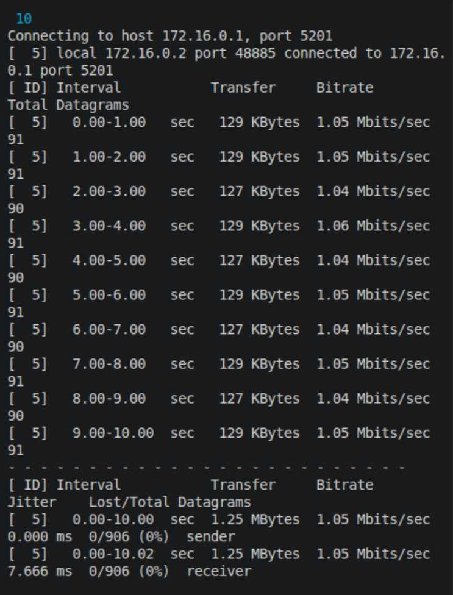
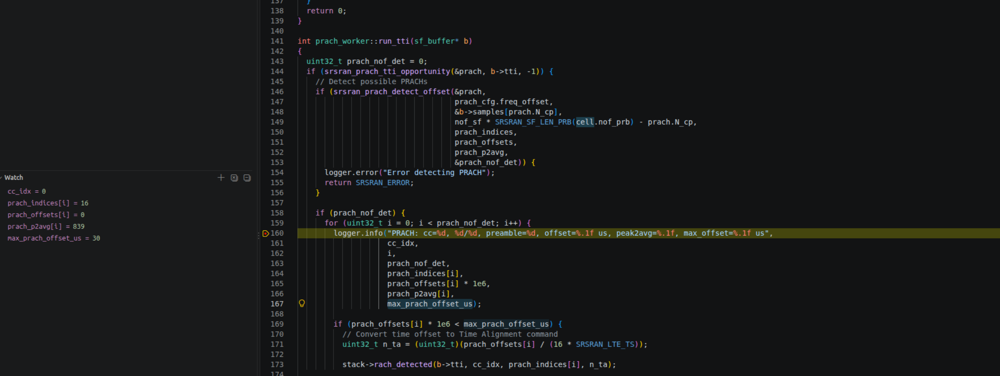

# Лабораторная работа №2

## PRACH преамбула в srsran_4G

**Студент:** Гмыря Ярослав Александрович 

**Группа:** ИА-332  

---

## Цель работы

Скачать и скомпилировать проект srsRAN_4G. Найти преамбулу PRUCH с помощью отладчика

## Ход работы

### Процесс RA

 Устройство (UE)                          Базовая станция (gNB)

       |                                           |
       | ------ Msg1: RACH Preamble -------------> |
       |                                           |
       | <----- Msg2: Random Access Response ----- |
       |                                           |
       | ------ Msg3: Scheduled Transmission ----> |
       |                                           |
       | <----- Msg4: Contention Resolution ------ |
       |                                           |

### Установка ZMQ

ZMQ — это высокопроизводительная библиотека асинхронного обмена сообщениями. Можно сказать, что это сокеты на максималках.Используется в проекте для связи между элементами сети (замена железу)

```
sudo apt-get install libzmq3-dev
```

### Установка проекта

```
git clone https://github.com/srsRAN/srsRAN_4G.git
```

### Компиляция

```
cd srsRAN_4G
mkdir build
cd build
cmake -DCMAKE_BUILD_TYPE=Debug ../
make
make test
```

### Настройка launch.json

```
{
    "version": "0.2.0",
    "configurations": [
        {
            "name": "Debug srsENB",
            "type": "cppdbg",
            "request": "launch",
            "program": "${workspaceFolder}/build/srsenb/src/srsenb", # расположение бинаря, который дебажим
            "args": [
                "enb.conf"  # передаем в бинарь конфиг для базы
            ],
            "cwd": "${workspaceFolder}/build/srsenb/src" # указываем рабочую директорию
        }
    ]
}
```

### Точка останова

Прием PRACH преамбулы находится в `srsenb/src/phy/prach_worker.cc:run_tti()`. В этой функции вызывается функция srsran_prach_detect_offset(), которая запишет в поле `prach` структуры `prach_worker`.

В этой функции нужно поставить точку останова, чтобы во время дебага посмотреть на параметры преамбулы.

### Запуск

Запускаем кору:

```
sudo ./srsepc/src/srsepc
```

База запускается через интерфейс VScode 

Запускаем UE
```
sudo ./srsue/src/srsue --rf.device_name=zmq --rf.device_args="tx_port=tcp://*:2001,rx_port=tcp://localhost:2000,id=ue,base_srate=23.04e6" --gw.netns=ue1
```

### Тестирование

Нагрузим сеть с помощью iperf3

```
sudo ip netns exec ue1 iperf3 -u -c 172.16.0.1 -R -i 1 -t 10
```



### Результат 


Из изображения видно, что была принята преамбула с номером 16.

### Используемые ресурсы

1. https://docs.srsran.com/projects/4g/en/latest/app_notes/source/zeromq/source/index.html#running-a-full-end-to-end-lte-network-on-a-single-computer
2. https://docs.srsran.com/projects/4g/en/latest/general/source/4_troubleshooting.html#building-with-debug-symbols
