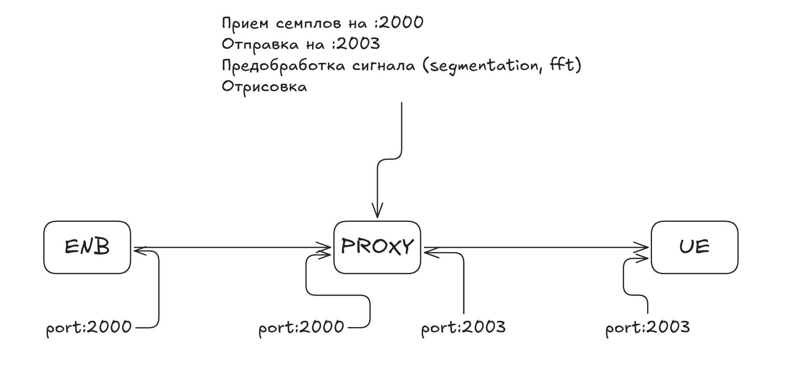
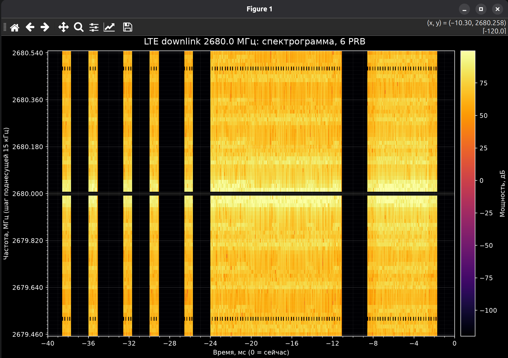

# Лабораторная работа №3

## Визуализация ресурсных блоков в LTE

**Студент:** Гмыря Ярослав Александрович 

**Группа:** ИА-332  

---

## Цель работы

Написать на Python прокси-сервер, который будет стоять между UE и ENB, он должен забирать семплы с базовой станции, отправлять их на UE + отрисовывать эти семплы, сделав предварительную обработку

## Ход работы

### Простой прокси

### Результат

Периодически стоящие "столбики" это вероятнее всего контрольные каналы (PDCCH, PCFICH и тд), а пролетающий периодически большой прямоугольник - широковещательная информация.