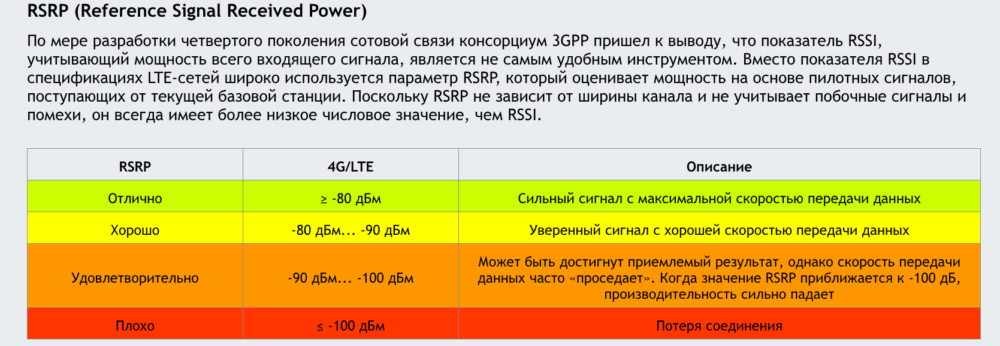
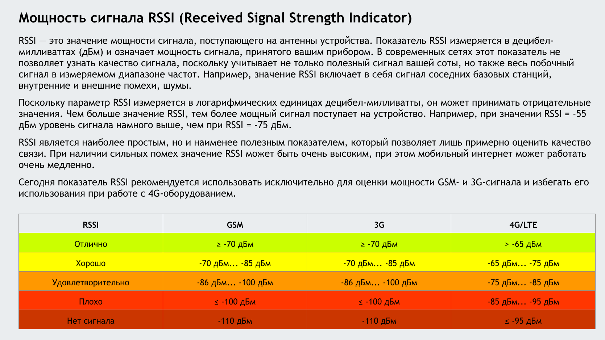
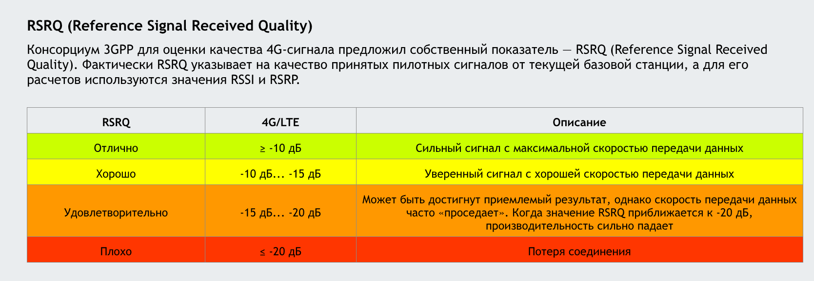
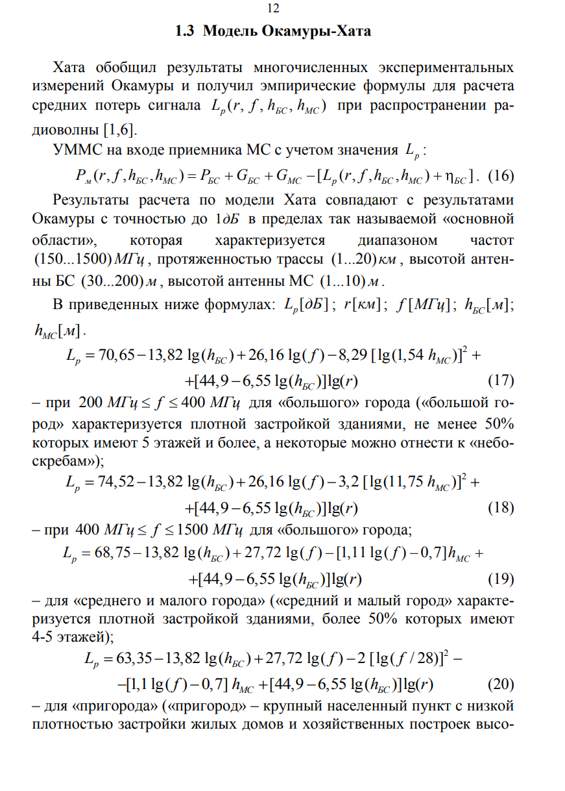
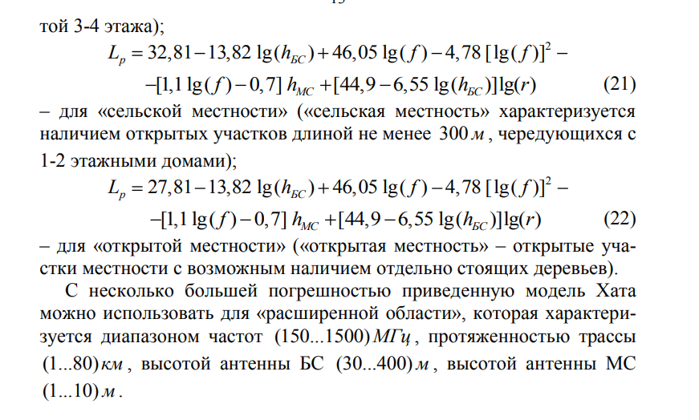
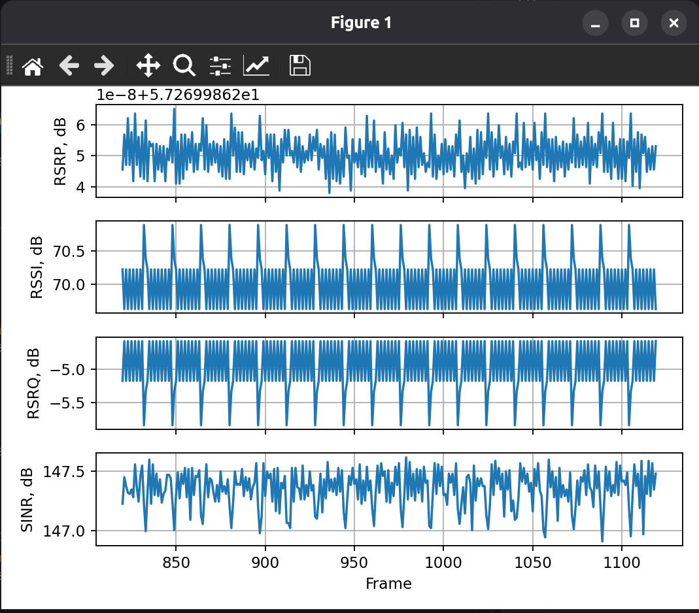
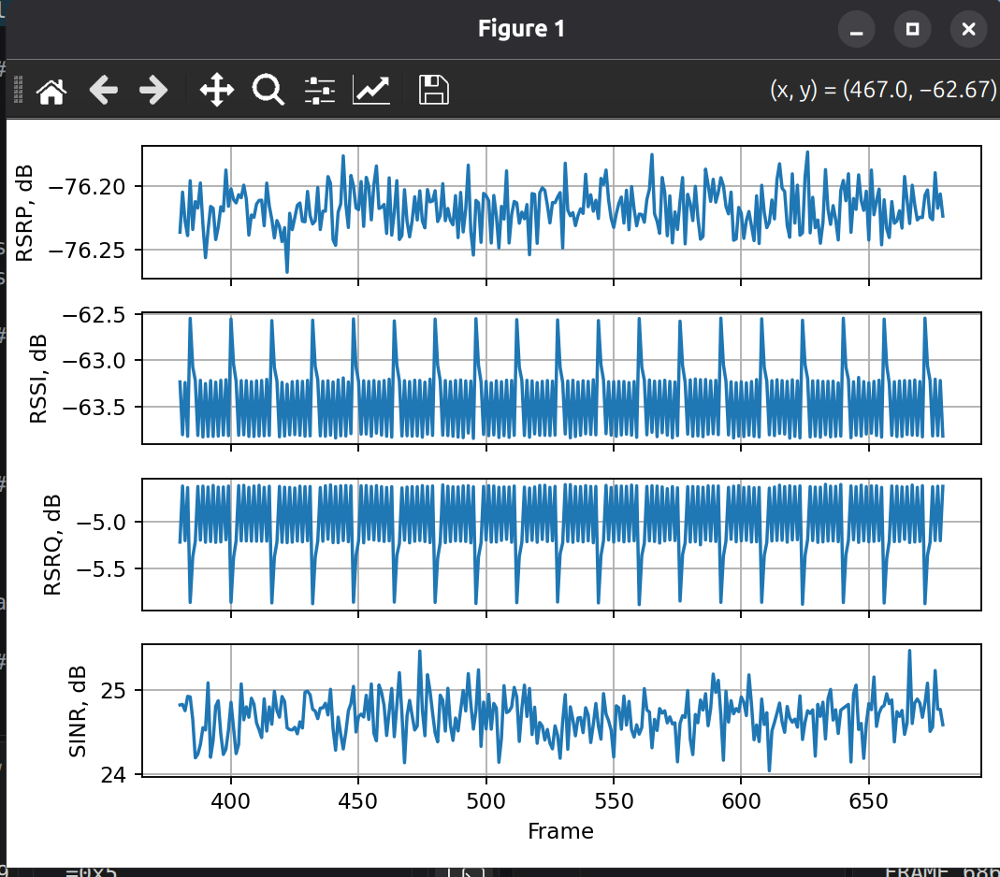
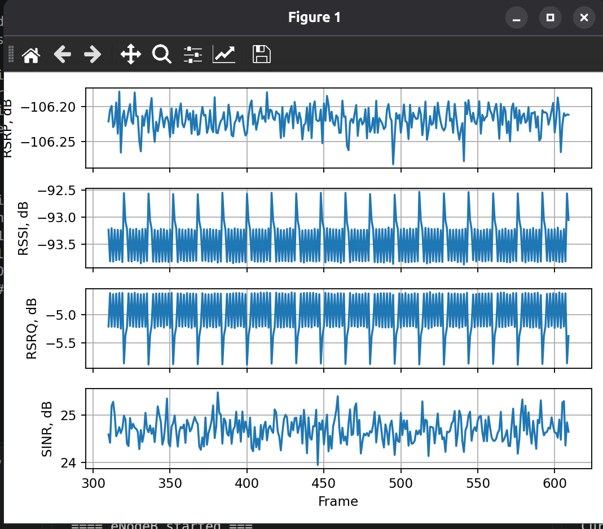

# Лабораторная работа №4

## Измерения качества сигнала в LTE, модель потерь Окомура-Хата

**Студент:** Гмыря Ярослав Александрович 

**Группа:** ИА-332  

---

## Цель работы

Изучить модель затуханий Окомура-хата, применить ее к сигналу из srsran_4g, а также вычислить метрики RSSI, RSRP, RSRQ, SINR для сигнала.

# 1. Термины

* RSRP (Reference Signal Received Power) — мощность опорного (пилотного) сигнала базовой станции в дБм. Показывает «чистую» силу сигнала без учёта шумов в полосе и помогает понять удалённость от вышки и пробиваемость сигнала.

* RSSI (Received Signal Strength Indicator) — общая мощность всего принятого сигнала в полосе в дБм, включая полезный сигнал, шумы и помехи. Используется как грубый ориентир.

* RSRQ (Reference Signal Received Quality) — качество опорного сигнала в дБ. Связывает RSRP и RSSI и отражает уровень помех и загруженность базовой станции.

* SINR (Signal to Interference and Noise Ratio) - отношение сигнала к шуму и интерференции. Отражает общее качество сигнала

# 2. Вычисления в коде

Метрика	Что берётся	Усреднение
RSRP	mean(|rx|²) по 12 RS
RSSI	sum(|grid|²) по 72 поднесущим
RSRQ	6 · RSRP / RSSI
SINR	mean(sig) / mean(noise)

# 3. Модель Окомура-хата

Широко распространенная эмпирическая модель распространения радиоволн, которая используется для прогнозирования потерь сигнала (затухания) в наземных системах подвижной радиосвязи и сотовой связи.

# 4. Результат

Снизу результаты измерений БЕЗ модели потерь. Здесь значение SINR имеет слишком огромное значение, которое в реальности не встречается. Это связано с отключенной моделью ошибок. Значения RSSI, RSRP, RSRQ тоже имеют идеальные значения (судя по таблице).

Снизу измерения с включенной моделью ошибок. SINR сразу упал, но все равно остается достаточно высоким. Параметры RSSI, RSRP, RSRQ, SINR тоже стали меньше

Измерения с нулевым усилением антенны
