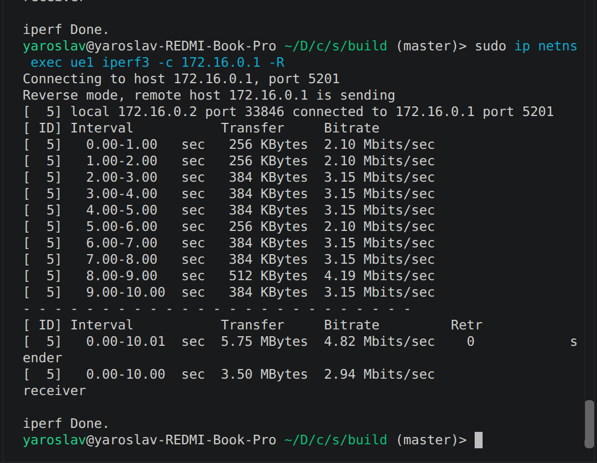
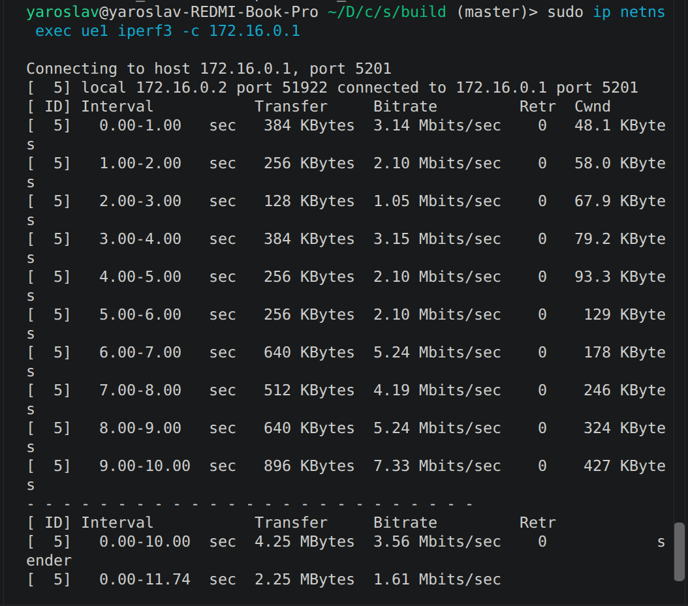
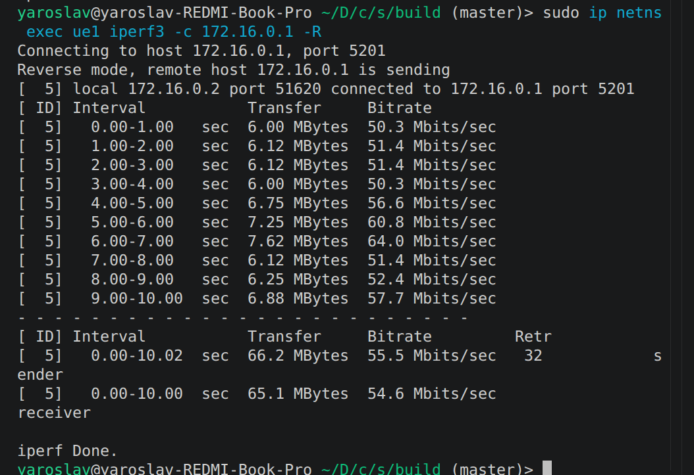
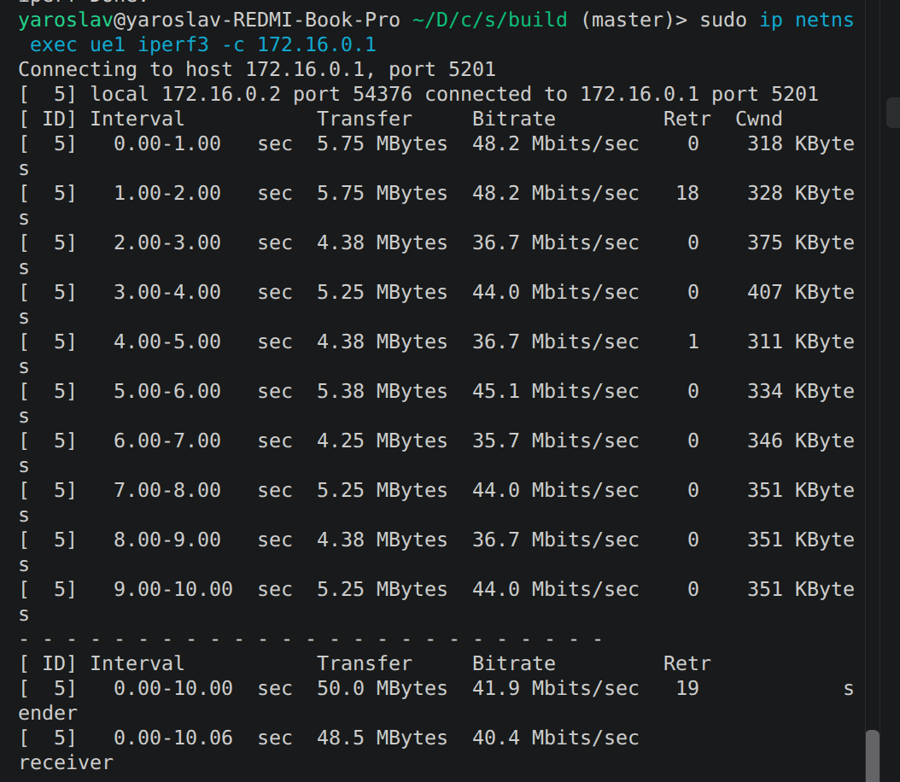

# Лабораторная работа №3

## Визуализация ресурсных блоков в LTE

**Студент:** Гмыря Ярослав Александрович 

**Группа:** ИА-332  

---

## Цель работы

Запустить проект srsran_4g на USRP B200. Добиться подключения UE к ENB.

## Ход работы

### Запуск проекта на USRP B200

Запуск epc:
`sudo srsepc`

Запуск srsenb:
`sudo UHD_IMAGES_DIR=/usr/share/uhd/images srsenb enb.conf`

Запуск srsenb:
`sudo UHD_IMAGES_DIR=/usr/share/uhd/images srsue`

Для корректной работы проекта с USRP/SDR нужно, чтобы было известно, где лежат дрова для USRP/SDR. Для этого нужно завести переменную окружения UHD_IMAGES_DIR=/usr/share/uhd/images. 

По каким то причинам бинари не видят переменную окружения, хотя она задана в bashrc. Я передаю переменную окружения явно, что решает проблему

Результаты:

.png>)

### Сравнние пропускной способности

Чтобы сравнить между собой скорости полосах 6 и 100 PRB, будем использовать утилиту iperf3. Перед работой с iperf3 необходимо создать net namespace:

```
sudo ip netns add ue1
sudo ip netns list
```

и запустить ue с флагом --gw.netns=ue1

Команды для iperf3:
```
sudo ip netns exec ue1 iperf3 -c 172.16.0.1 -R - DL
sudo ip netns exec ue1 iperf3 -c 172.16.0.1 -R - UL
```

### Результаты

#### DL 6PRB


#### UL 6PRB


#### DL 100PRB


#### UL 100PRB


Вывод: чем шире полоса, тем выше пропускная способность в обоих направлениях